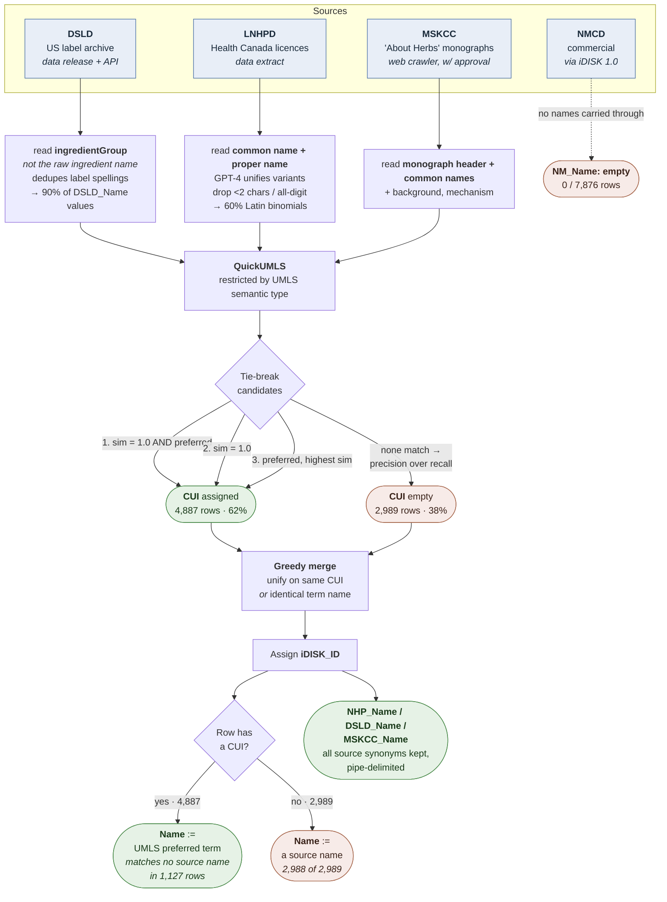

# How iDISK 2.0 builds the DSI table

**Status:** verified against the shipped CSVs
**Date:** 2026-09-07
**Data:** [`datasets/iDISK2.0/Data/Entity/DSI.csv`](../datasets/iDISK2.0/Data/Entity/DSI.csv) (7,876 rows), mirrored as [`compiled/dsi.csv`](../datasets/iDISK2.0/compiled/dsi.csv)
**Papers:** [Hou et al., JMIR 2025](pdfs/2025-hou-ds-rag-llm-jmir.pdf) (iDISK2.0 — the shipped version) · [Rizvi et al., JAMIA 2020](pdfs/2020-rizvi-idisk-jamia.pdf) (iDISK 1.0 — original design)

Where each column of the dietary supplement ingredient table comes from: how
`Name` is chosen, how `CUI` is assigned, and how the per-source name columns
survive the merge.

---

## 1. The pipeline



---

## 2. `CUI` — assigned first, and it drives everything else

Per-source ingredient strings were mapped to UMLS with **QuickUMLS**, restricted
by UMLS semantic type. Where QuickUMLS returned several candidates, a strict
tie-break applied, in order:

1. similarity 1.0 **and** flagged preferred
2. similarity 1.0 (even if not preferred)
3. flagged preferred, highest similarity

**If none of the three hit, no CUI was assigned** — deliberately, to protect
mapping precision. Hence 38% of rows carry no CUI.

| | rows | share |
|---|---|---|
| real CUI (`C`-prefixed) | 4,887 | 62.0% |
| empty cell | 2,954 | 37.5% |
| literal string `'None'` | 35 | 0.4% |

> **Data wart.** 35 rows hold the four-character string `None`, not an empty
> cell. Filter with `.startswith('C')`, never on truthiness — otherwise those 35
> read as valid CUIs.

Distinct real CUIs: 4,887 across 4,887 rows.

---

## 3. `Name` — the UMLS preferred term when there is one

This is the part neither the papers nor the dataset README state, and it is the
most likely thing to trip up downstream use. The data settles it unambiguously:

| | Name matches a source name | Name matches none |
|---|---|---|
| **has real CUI** | 3,760 | **1,127** |
| **no CUI** | 2,988 | 1 |

Where a CUI exists, `Name` is the **UMLS preferred term**, and it frequently
matches *no* string any source used. Where no CUI was assigned, `Name` falls
back to a source name in 2,988 of 2,989 cases.

How often `Name` differs from every value in its own single source column,
counting only single-source rows that **also carry a CUI** — i.e. rows where
UMLS had a preferred term available to override the source name:

| source (sole source, CUI present) | n | `Name` differs |
|---|---|---|
| `DSLD_Name` | 1,648 | 512 (31.1%) |
| `NHP_Name` | 2,055 | 397 (19.3%) |
| `MSKCC_Name` | 36 | 5 (13.9%) |

Over *all* single-source rows the rates are lower, because the CUI-less rows
can only ever take a source name: DSLD 512/3,058 (16.7%), LNHPD 397/3,468
(11.4%), MSKCC 5/71 (7.0%).

### Why this matters

UMLS preferred terms can be far more general, or far more chemical, than the
ingredient the sources described:

| iDISK_ID | `Name` | CUI | what it actually pools |
|---|---|---|---|
| `DSI000155` | **`acid`** | C0001128 | ~100 distinct acids from LNHPD + DSLD |
| `DSI000110` | **`Oil`** | C1517288 | seal, palm, pumpkinseed, patchouly, calamari… |
| `DSI000007` | **`2-amino-2-deoxy-D-glucose`** | C0017718 | glucosamine — no source calls it this |
| `DSI000092` | **`Melissa officinali`** | C1008143 | truncated form of *Melissa officinalis* |

> **Carry this downstream.** `Name` is a UMLS label, not a supplement label. Do
> not use it as a display string or as a join key against DSLD or label text —
> use the per-source name columns for that.

---

## 4. `NHP_Name` / `DSLD_Name` / `MSKCC_Name` — retained provenance

Pipe-delimited (` | `) lists of every name the merged concept carried in that
source. These survive the merge intact, which is what makes source-faithful
matching possible at all.

| column | populated | share |
|---|---|---|
| `NHP_Name` | 4,690 | 59.5% |
| `DSLD_Name` | 4,317 | 54.8% |
| `MSKCC_Name` | 279 | 3.5% |
| `NM_Name` | **0** | **0.0%** |

### Which source field each column reads

Per Table 1 of the 2020 paper, plus the 2025 paper's revision of the DSLD step:

| column | source fields read |
|---|---|
| `DSLD_Name` | **Ingredient Group** (2.0) · *Synonym* (1.0) |
| `NHP_Name` | **Common name**, **Proper name** |
| `MSKCC_Name` | monograph header + *Common names* section |
| `NM_Name` | *Also known as*, *Synonym*, *Taxonomical synonym*, *Scientific name* — none carried through |

#### `DSLD_Name` — the ingredient **group** label, not the raw ingredient string

DSLD lists the same ingredient once per label under many spellings
(*Fiber gum acacia*, *Acacia gum extract*, *Acacia*). Each `ingredientRows`
entry in the DSLD label JSON carries a `name`, an `ingredientGroup`, an optional
`alternateNames`, and `forms[].name` for salt/ester variants:

```json
{ "name": "Thiamine", "ingredientGroup": "Thiamin", "uniiCode": "X66NSO3N35",
  "alternateNames": [],
  "forms": [ { "name": "Thiamine Mononitrate", "ingredientGroup": "Thiamin" },
             { "name": "Vitamin B1",           "ingredientGroup": "Thiamin" } ] }
```

iDISK 2.0 deduplicates by **`ingredientGroup`** — the field that already
collapses those variants. Checked against all 214,780 labels in
[`datasets/DSLD-full-database-JSON/`](../datasets/DSLD-full-database-JSON/):

| where the 5,978 distinct `DSLD_Name` values appear in the dump | n | share |
|---|---|---|
| `ingredientGroup` | **5,384** | **90.1%** |
| `name` | 3,393 | 56.8% |
| `forms[].name` | 2,207 | 36.9% |
| `alternateNames` | 499 | 8.3% |
| no match anywhere (renamed/withdrawn since the snapshot) | 503 | 8.4% |

3,789 of 4,317 populated rows consist *entirely* of group labels, and iDISK
covers **5,338 of DSLD's 5,540 groups (96.4%)**. So `DSLD_Name` is very nearly
the DSLD ingredient-group vocabulary transplanted whole.

> The group labels come through verbatim, parentheticals included — `DSI000011`
> carries *Vitamin A (retinol)*, *Vitamin A (mixed)*, *Vitamin A (not
> specified)*. These are DSLD's own group names, not parsing debris.

iDISK **1.0** worked differently: no group field, so it read the free-text
*Synonym* list and cleaned it with hand-written regexes stripping dosage, dose
forms, TGA plant parts and trademark symbols. That is what produced the
documented `NITRO2GRANIT`-as-pomegranate error — a product name that survived
`™`-stripping and entered the vocabulary as a synonym. The 2.0 group-based
approach removes that whole error class.

#### `NHP_Name` — common name and proper name from the licence record

LNHPD licences record an ingredient's **proper name** (the scientific/Latin
binomial) and its **common name** (vernacular). iDISK pools both into one
column, which is why the values are a mix:

- 3,768 of 6,309 distinct values (59.7%) are Latin binomials — *Serenoa
  repens*, *Foeniculum vulgare subsp. vulgare*
- the rest are common names — *Maize*, *Glucosamine HCL*
- 23 retain French-language text (*Sulfate de glucosamine…*), LNHPD being
  bilingual

Cleaning was LLM-assisted: GPT-4 unified inconsistent expressions, and pattern
filters dropped names under 2 characters or made only of digits or punctuation
(LNHPD contains literal ingredient names like `8` and `%`).

Mean 1.3 values per row, but up to 58 — homeopathic preparations pool heavily
(`DSI000147` *Kali* holds 21 *Kali* salts).

**`Source Material` rides along with this column**: 4,252 of its 4,277
populated cells (99.4%) sit on rows that have an `NHP_Name`, confirming LNHPD as
its only source.

#### `MSKCC_Name` — crawled monographs

Web-crawled *About Herbs* monographs, only 279 of them. This is why
`MSKCC_Name`, `Background`, `Mechanism of action` and `Common Names` all sit at
exactly 3.5%.

### Two columns are empty by construction

`NM_Name` (0/7,876) and `Safety` (0/7,876) are schema placeholders. NMCD is
commercial, and the 2025 paper says its data was "derived from information that
already exists within iDISK" — no NMCD names were carried into this release.
This is the same shape as the [Purpose/Risk gap in the DSP
table](dsld-purpose-risk-findings.md): a regulatory/licensing boundary showing
up as a perfectly clean column of nulls, not a parsing bug.

Attribute fill rates overall:

| column | populated | share | sole source |
|---|---|---|---|
| `Source Material` | 4,277 | 54.3% | LNHPD |
| `Background` | 279 | 3.5% | MSKCC |
| `Mechanism of action` | 277 | 3.5% | MSKCC |
| `Common Names` | 279 | 3.5% | MSKCC |
| `Safety` | 0 | 0.0% | — (NMCD only) |

---

## 5. The merge, and what it leaves behind

Integration is **greedy**: initialise the vocabulary from one database, then
fold in the rest, unifying DSI entities that share **the same UMLS CUI or an
identical term name**. Survivors get an `iDISK_ID` (`DSI######`).

**The invariant holds exactly** — verified: no real CUI appears on two rows.

But CUI-less rows can only merge on exact string identity, so under-merging is
the expected residue of the precision-first CUI policy:

- **123 names still collide** case-insensitively — `l-valine` ×3,
  `l-cysteine` ×3, `allium sativum` ×2, `camellia sinensis` ×2.
- The 2020 paper flags the same failure mode directly: LNHPD's *Helichrysum
  italicum* never merged with DSLD's *Helichrysum*, because the method requires
  exact matches between synonym strings.

Merge reach, by which source columns a row ended up with:

| NHP | DSLD | MSKCC | rows |
|---|---|---|---|
| ✓ | | | 3,468 |
| | ✓ | | 3,058 |
| ✓ | ✓ | | 1,070 |
| ✓ | ✓ | ✓ | 133 |
| | | ✓ | 71 |
| | ✓ | ✓ | 56 |
| ✓ | | ✓ | 19 |
| | | | 1 |

209 rows pool six or more source names into a single concept.

---

## 6. Relationship to `DSP.csv`

DSI and DSP are separate entity tables joined by one relation file,
[`Relation/dsp_dsi.csv`](../datasets/iDISK2.0/Data/Relation/dsp_dsi.csv) —
**317,062 `has_ingredient` edges**, the single largest relation in iDISK 2.0.
There is no ingredient column on `DSP.csv` and no product column on `DSI.csv`;
the edge list is the only link.

```
DSP.csv                    dsp_dsi.csv                     DSI.csv
iDISK_ID  DSP######  ◄──── DSP, has_ingredient, DSI ────►  iDISK_ID  DSI######
Name                       Source ∈ {NHP, DSLD}            Name
Company_Name                                               CUI
NHP_ID / DSLD_ID           317,062 edges                   NHP_Name / DSLD_Name
Purpose / Risk             0 dangling refs                 MSKCC_Name
```

Referential integrity is clean — every edge resolves on both ends, and there
are no duplicate `(DSP, DSI)` pairs. Shape of the graph:

| | value |
|---|---|
| products with ≥1 ingredient | 71,815 / 163,806 (**43.8%**) |
| ingredients used by ≥1 product | 4,858 / 7,876 (61.7%) |
| ingredients per product | mean 4.4, median 1, max 154 |
| products per ingredient | mean 65, median 4, max 7,759 |

### The edges are almost entirely LNHPD

| edge `Source` | edges |
|---|---|
| NHP | 316,161 (99.7%) |
| DSLD | 899 |
| NHP, DSLD | 2 |

Which produces the same clean split as the [Purpose/Risk
gap](dsld-purpose-risk-findings.md), in the graph rather than the columns:

| product provenance | products | have ≥1 ingredient edge |
|---|---|---|
| LNHPD only | 71,156 | 71,087 (**99.9%**) |
| **DSLD only** | **92,442** | **520 (0.6%)** |
| both | 208 | 208 (100%) |

**91,922 DSLD-only products — 56% of the whole DSP table — are isolated
nodes.** They carry a name and a company but connect to nothing, so any
traversal from ingredient to product, or any product-level aggregation, silently
sees only the Canadian half of the database.

> This matters more than the Purpose/Risk gap. That gap is irreducible — US
> labels have no regulator-approved indication field to read. **This one is
> not:** DSLD publishes full ingredient lists, and the 2025 paper says
> `ingredientRows` *was* extracted from DSLD. The edges are simply absent from
> the shipped release.

### It is recoverable from the local dump

Unlike Purpose/Risk, the missing data is already on disk. Sampling the 91,922
isolated products against
[`datasets/DSLD-full-database-JSON/`](../datasets/DSLD-full-database-JSON/):

- **299 of 300** sampled labels are present in the dump and carry
  `ingredientRows`; none were missing.
- Resolving each label's `ingredientGroup` values through the existing
  `DSLD_Name` vocabulary (section 4) — a plain dictionary lookup, no new
  UMLS mapping — matches **95.9% of ingredient slots** (8,234/8,584 over 1,500
  products), giving **97.7% of those products at least one edge**.

Most of the residue is structural placeholders rather than real misses:
`Blend`, `Proprietary Blend`, `Header`, `TBD`.

The rest is a **vocabulary gap, not a missing concept**. The two largest
unmatched groups, `Niacin` (167) and `Pantothenic Acid` (22), both *have* DSI
rows — `DSI000096` and `DSI000017`. Their `DSLD_Name` lists just never contain
the bare label, only parenthesised variants:

```
DSI000096  Name: Niacin
           DSLD_Name: Niacin (Vitamin B3) | Vitamin B3 (Niacin) | Vitamin B3 (unspecified) | …
```

So falling back to the canonical `Name` column when the group label misses
raises the match rate from 95.9% to **98.2%** on the same sample. Do both
lookups; the fallback is free and closes most of the gap.

Order-of-magnitude: this would add roughly 500k edges to the existing 317k.

---

## 7. Caveat on section 3

The naming rule in section 3 is **inferred from the data**, not stated in either
paper. The 1,127-vs-1 asymmetry makes it about as certain as inference gets —
rows with a CUI routinely have a `Name` matching no source, rows without one
essentially never do — but it is not a documented claim, and a future iDISK
release could change it without saying so.

Everything else here is either stated in the papers (extraction scope,
QuickUMLS tie-break, greedy merge rule) or a direct count over the shipped CSV.
