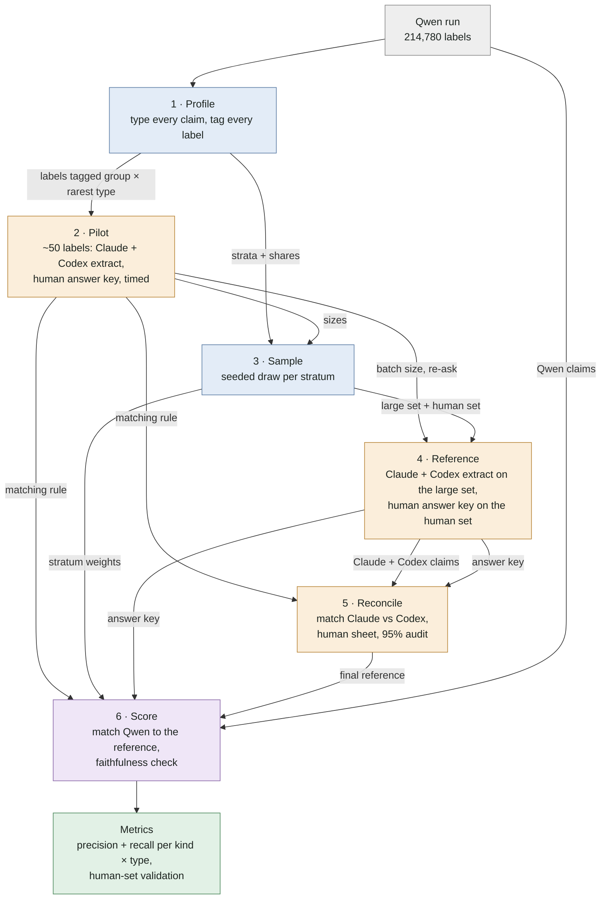
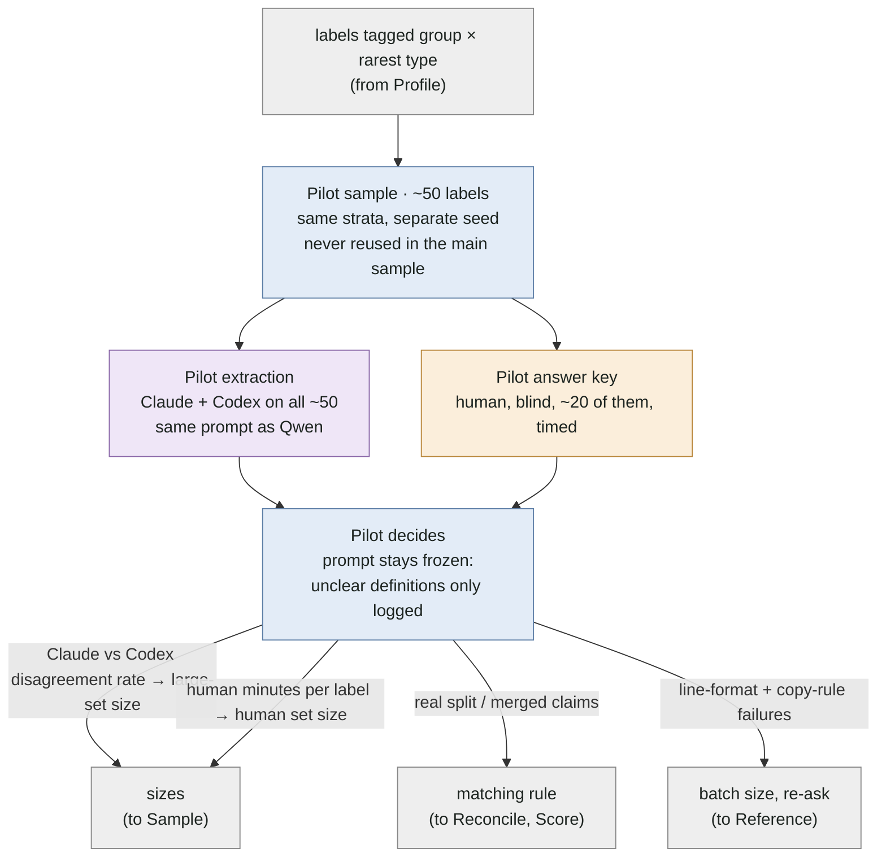
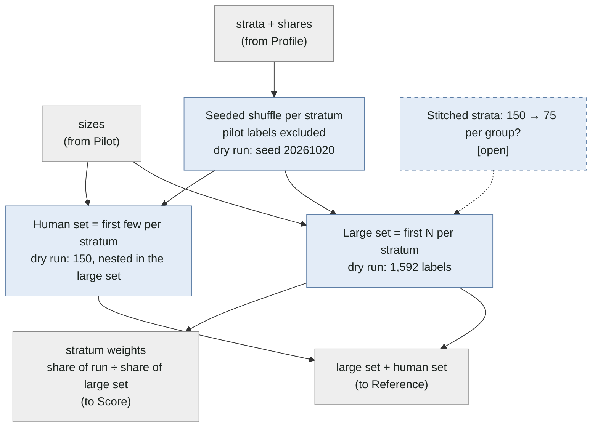
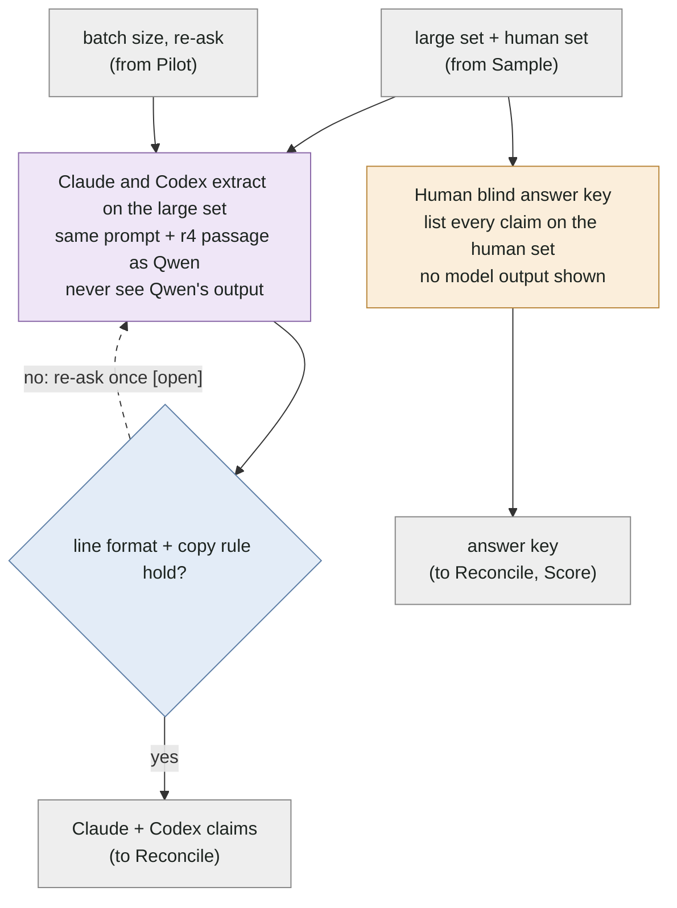
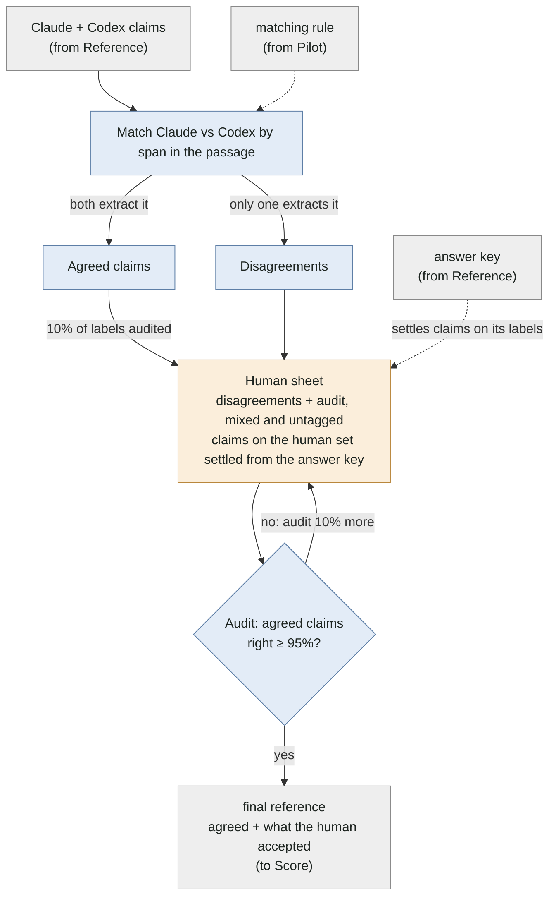
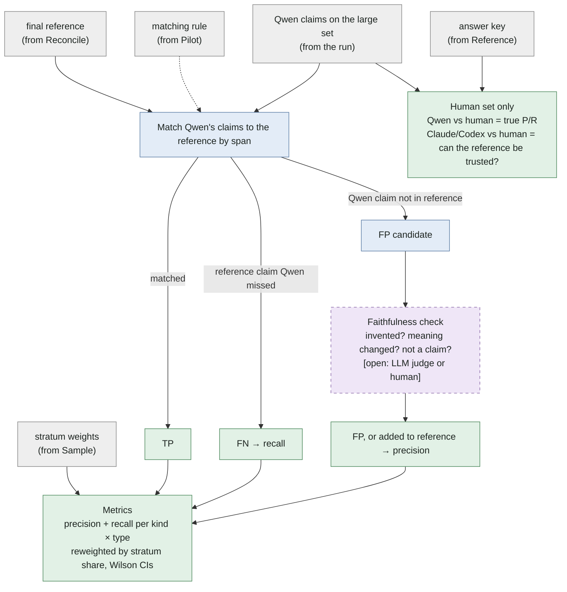

# Purpose/risk extraction evaluation: samples, judges, verdicts, metrics

- **Status:** draft, design in progress (grilling session 2026-10-19, to be continued)
- **Date:** 2026-10-19
- **Scope (proposed):** new `engine/services/extraction_eval/`, new
  `engine/models/claude_cli_model.py` and `codex_cli_model.py`, new
  `engine/controllers/judge_controller.py`, new prompt folder
  `engine/repositories/prompts/extraction_judge/`, a stored profile in each run's `raw/` and
  an `eva/` folder per run, read and written through `engine/repositories/dsld/runs/`, a
  notebook `15_extraction_eval.ipynb`.

Builds `docs/extraction-quality-check.md` (the design: what is measured and why) and
delivers what the 2026-10-17 progress report (§3, "Evaluation plan") promised. Governed by
ADR 0002 (latest version) and ADR 0003. Reads the extraction run; changes nothing about
the extraction, its prompt or its `config_hash`.

## Where this stands

Every decision below is tagged:

- **[agreed]** the user said yes.
- **[proposed]** recommended in the session, not yet answered. Confirm or change these first.
- **[open]** not yet discussed.

Questions keep their session numbers (Q1–Q29) so the transcript can be followed.

## Terms

| term | meaning |
|---|---|
| **claim** | one item the model extracted: one entry of a run row's `purpose` or `risk` list |
| **kind** | the bucket the model put a claim in: `purpose` or `risk` |
| **type** (faithfulness type) | deterministic, claim text vs passage: `verbatim` (substring of the passage), `stitched` (not verbatim, every word from one passage line), `spread` (every word in the passage, over several lines), `invented` (a word not in the passage) |
| **group** | a label's class by what the model extracted: `both`, `purpose only`, `risk only`, `neither` |
| **stratum** | one sampling cell: kind × type for claims, group for labels |
| **case** | one thing judged: a *claim case* (one sampled claim) or a *label case* (one sampled label) |
| **judge** | Claude, Codex, or the human |
| **verdict** | one judge's answer to one case |
| **final verdict** | the verdict the metrics use: the human's if given, else the two judges' matching verdict |

## What is evaluated

Run `full214780-r4-2610131822-0` (214,780 labels; 466,630 purpose and 355,134 risk
claims; the 7 rows rerun with a longer limit included). One evaluation pins one run; a new
prompt or renderer gets a new evaluation. **[proposed, Q3]**

Two questions, from the design doc **[agreed]**: is each claim **faithful** to the label,
and is it in the **right bucket** (a real purpose, a real risk, or neither)?

They need two samples with different units, because a missed claim is not in the output
and can only be found by reading a label:

| sample | unit | strata | size | answers |
|---|---|---|---|---|
| claims | extracted claim | kind × type | 1,200 | precision: is what was extracted right? |
| labels | label | group | 600 | FNR / FPR per kind: were claims missed, or extracted where the label has none? |
| pilot | mixed | — | 50 | fixes the rubric; never counted in the metrics **[agreed, Q16]** |

### Claim sample: kind × type **[proposed, Q13, Q14]**

| kind | type | claims in the run | sampled |
|---|---|---|---|
| purpose | verbatim | 455,043 | 300 |
| purpose | stitched | 10,408 | 100 |
| purpose | spread | 508 | 100 |
| purpose | invented | 671 | 100 |
| risk | verbatim | 353,560 | 300 |
| risk | stitched | 1,058 | 100 |
| risk | spread | 184 | 100 |
| risk | invented | 332 | 100 |

Verbatim is raised from the design doc's 100 to 300 because, reweighted, it carries 97.5% of
purposes and 99.6% of risks: at 100 the headline precision CI is about ±6 points
(90/100 → 83–95%), at 300 about ±3.5 (270/300 → 86–93%).

Each sampled claim also records its label's group, for a descriptive per-group breakdown
only. Crossing group with type as 16 equal strata was considered and rejected: the
`neither` group has no claims, single-kind groups have no claims of the other kind, four
cells hold fewer than 100 claims (purpose-only spread 91 / invented 94, risk-only spread 53
/ invented 27), and it would mean ~1,465 judged claims for a breakdown nothing yet asks for.

### Label sample: group, 150 each **[proposed]**

| group | labels | share |
|---|---|---|
| both | 124,647 | 58.0% |
| purpose only | 25,418 | 11.8% |
| risk only | 46,860 | 21.8% |
| neither | 17,855 | 8.3% |

A label's group decides which error it can show (design doc, "The four groups"). One label
case answers both kinds **[proposed, Q23]**; agreement and metrics are still per kind.

### Label sample for reference extraction (dry run) **[grilling]**

Alternative to the claim and label samples above, under discussion: Claude and Codex
extract with Qwen's prompt on sampled labels, and Qwen is scored against that reference,
so the sampling unit is the label and claims come along with it. Strata are group × the
label's rarest claim type: `rare` (≥1 `spread` or `invented` claim), `stitched` (≥1
`stitched`, none rarer), `verbatim` (all verbatim). Quotas: rare 100 per group (all, if
fewer), stitched 150, verbatim 150 (300 for `both`, which carries the headline), `neither`
300. "Yours" is the human's blind set: the first labels of each stratum's seeded order, so
it is nested in the large set and stays fixed if the large set grows. Dry run on
full214780-r4, seed 20261020; counts are Qwen's claims (P = purpose, R = risk). The
"yours" row counts Qwen's claims on the human's labels, exact for this draw; it is not the
human's work, which is annotating those 150 labels blind (Qwen's claims are never shown).

| group | stratum | in run | large | weight | yours | P verb | P stit | P spread | P inv | R verb | R stit | R spread | R inv | claims |
|---|---|---|---|---|---|---|---|---|---|---|---|---|---|---|
| both | rare | 1,274 | 100 | 0.09 | 10 | 478 | 13 | 28 | 49 | 248 | 1 | 11 | 26 | 854 |
| both | stitched | 5,096 | 150 | 0.25 | 10 | 612 | 247 | – | – | 364 | 39 | – | – | 1,262 |
| both | verbatim | 118,277 | 300 | 2.92 | 20 | 946 | – | – | – | 578 | – | – | – | 1,524 |
| purpose_only | rare | 147 | 100 | 0.01 | 10 | 403 | 22 | 69 | 65 | – | – | – | – | 559 |
| purpose_only | stitched | 811 | 150 | 0.04 | 10 | 620 | 290 | – | – | – | – | – | – | 910 |
| purpose_only | verbatim | 24,460 | 150 | 1.21 | 20 | 372 | – | – | – | – | – | – | – | 372 |
| risk_only | rare | 80 | 80 (all) | 0.01 | 10 | – | – | – | – | 79 | – | 53 | 27 | 159 |
| risk_only | stitched | 112 | 112 (all) | 0.01 | 10 | – | – | – | – | 504 | 230 | – | – | 734 |
| risk_only | verbatim | 46,668 | 150 | 2.31 | 20 | – | – | – | – | 257 | – | – | – | 257 |
| neither | — | 17,855 | 300 | 0.44 | 30 | – | – | – | – | – | – | – | – | 0 |
| **large set** | | 214,780 | **1,592** | | | 3,431 | 572 | 97 | 114 | 2,030 | 270 | 64 | 53 | **6,631** |
| **yours** | | | | | **150** | 298 | 34 | 9 | 14 | 171 | 18 | 11 | 3 | **558** |

Weight = the stratum's share of the run ÷ its share of the large set. The stitched strata
are claim-heavy (long labels: ~2,900 of the 6,631 claims); cutting them to 75 per group
would leave ~5,200 claims **[open]**. `neither` brings no Qwen claims and feeds recall only.

### Phases of the reference-extraction design **[grilling]**



Blue: automatic. Purple: Claude / Codex. Orange: the human. Green: results. Grey: a
handoff to or from another phase. A phase is coloured by the most expensive actor in it
(human > Claude / Codex > automatic). Dashed border: **[open]**. The phase graphs below use
the same colours; their grey entry and exit nodes carry the edge labels above.

1. Profile: [01-profile.md](01-profile.md), "Flow".
2. [Pilot](#pilot)
3. [Sample](#sample)
4. [Reference](#reference)
5. [Reconcile](#reconcile)
6. [Score](#score)

#### Pilot



The pilot runs before the sample because the sample's sizes depend on it:

| pilot measures | decides |
|---|---|
| Claude vs Codex disagreement rate | large-set size (it sets the human sheet's workload) |
| the human's minutes per label | human set size (100, 150 or 200) |
| real split and merged claims | the span-matching rule |
| line-format and copy-rule failures | batch size, and whether re-asking is needed |

It cannot change the prompt: that stays Qwen's (otherwise the reference answers a different
task), and disagreements from unclear definitions are only logged as candidate fixes for a
later Qwen run. Pilot labels stay out of the main sample, because the matching rule is
tuned on them.

#### Sample



Strata, quotas and the dry-run counts: the table above. Taking the first labels of each
stratum's seeded order keeps the human set nested in the large set, and fixed if the large
set grows.

#### Reference



The human's first session: the answer key, as soon as the sample is drawn, alongside the
LLM extraction.

#### Reconcile



The human's second session: the sheet, after the extraction.

#### Score



Still open: who does the faithfulness check, an LLM judge or the human.

Every rate is reweighted by its stratum's share of the run:
`rate_overall = Σ_s share_s × rate_s`.

## The process

1. **Profile** (deterministic, every claim, no judge): see [01-profile.md](01-profile.md).
   Type per claim, group per label, counts per group × kind × type. Stored in the run's
   `raw/profile.jsonl` + `manifests/profile.json`, since type and group are decided
   deterministically after the run **[agreed 2026-10-21, Q11]**. Notebook 14's inline classifier moves here and becomes the one
   definition of the four types. The flags (rule-4 lexicon, purpose/risk collision,
   cut-context) and the other run-wide rates are not in its first version **[open]**.
2. **Sample.** Seeded stratified draw of the pilot and the evaluation set from the stored
   profile: see [02-sample.md](02-sample.md). Each case stores its stratum; the manifest
   keeps the stratum sizes. Stored once in the run's `eva/`; the store refuses to overwrite.
3. **Rubric pilot.** Both judges and the human label the 50 pilot cases independently.
   Disagreements are rubric problems: the rubric is clarified (ambiguous cases logged as
   candidate extraction-prompt fixes), then frozen; its hash goes in the manifest.
4. **Judge.** The service builds batches and runs both judges through the judge
   controller. Judges are blind: they never see the model's output, the strata or each
   other's verdicts **[proposed, Q22]**.
5. **Validate.** The controller rejects a verdict whose values are off the allowed lists,
   whose quote is not in the passage, or a case answered twice or not at all. It re-asks that
   judge once for just those cases; a second failure sends the case to the human sheet,
   never silently to "no" **[proposed, Q17]**.
6. **Compare and route.** Agreement is exact equality of the enum fields **[agreed, Q18:
   standardised outcomes]**. Claim cases: both `faithful` and `actual_kind` must match
   **[proposed, Q20]**. Label cases: `states_purpose` and `states_risk`, per kind; quotes
   are not compared (two judges may rightly quote different sentences).
7. **Human review.** The human sheet holds all disagreements plus a random 10% of
   agreements, with no judge columns (blind). The human labels first; a reveal sheet with
   the judges' verdicts is produced only after the human's verdicts are ingested.
8. **Final verdicts and trust check.** Final = human's verdict where given, else the agreed
   judge verdict. On the audited 10%, if agreeing judges match the human less than **95%**
   of the time, a further 10% is audited, repeated until it holds or all are audited
   **[agreed, Q19]**.
9. **Metrics.** The service returns tables; the notebook renders them (ADR 0002 §6).
10. **Notebook.** Runs the steps in order, shows the queues, draws the results figures in
    the style of the progress report §3 so the next report can use them **[proposed, Q10]**.

Expected human workload: 50 pilot + ~180 audit + disagreements (at 10–15%, ~180–270) ≈
400–500 cases, mostly quick verbatim claims. (Figures assume 1,200 claim + 600 label cases.)

## Verdicts

Every compared field is a closed list; free text only in `reason` and quotes, which are never
compared **[agreed, Q18]**.

**Claim case**

| field | values |
|---|---|
| `faithful` | `yes` · `invented` · `meaning_changed` |
| `actual_kind` | `purpose` · `risk` · `neither` |
| `reason` | free text |

The service derives the outcome, the judge does not: `TP` (faithful `yes` and
`actual_kind` = the model's kind), else the primary error by priority
**unfaithful > not_a_claim > wrong_bucket**. Both fields are stored, so another priority can
be applied without re-judging **[proposed, Q15]**.

**Label case**

| field | values |
|---|---|
| `states_purpose`, `states_risk` | `yes` · `no` |
| `purpose_quote`, `risk_quote` | required when `yes`; must be a substring of the passage; empty when `no` |
| `reason` | free text |

Label-level cell per kind = the model's group (extracted ≥1 of that kind or not) × the final
`states_<kind>`: TP / FP / FN / TN.

Every stored verdict records: case id, judge, model and version, date, rubric hash, attempt.

### Case ids **[proposed, Q21]**

Built from what the case is, so a verdict joins back to the run with no lookup table:

- claim case `claim:<dsld_id>:<kind>:<index>`: index = position in that row's `purpose` /
  `risk` list (stable, the run is pinned)
- label case `label:<dsld_id>`

The claim text and passage always travel with the id in packets and on the human sheet; the
id is the join key, because claim text is not unique (e.g. "keep out of reach of children"
on thousands of labels, collisions within a label) and is fragile as a key.

## Metrics

| metric | level | from |
|---|---|---|
| precision, FDR | claim, per kind × type and reweighted per kind | claim final verdicts |
| error split (unfaithful / not a claim / wrong bucket) | claim, per type | same |
| meaning-kept rate | claim, per type | `faithful` |
| per-group breakdown | claim, descriptive | recorded group |
| FPR, FNR, precision, recall | label, per kind, reweighted | label final verdicts |
| Claude vs Codex: agreement, Cohen's κ | judge | verdicts |
| each judge vs human: accuracy, κ | judge | human-reviewed cases |
| agreement-was-right | judge | audited 10% |
| deterministic rates (type shares, sources, lexicon, collisions, run health) | every claim | profile |

All rates with 95% Wilson CIs. BLEU/ROUGE/BERTScore/perplexity are not used (design doc).

Later and optional, after the promised core: the gold1000 agreement baseline and the ~300
flagged claims as their own group, never mixed into the rates **[proposed, Q8]**.

## Architecture **[proposed, Q2, Q25]**

The evaluation is in the engine, not a notebook: it is a multi-day process whose steps read
each other's files, its reweighting, Wilson, κ, quote check and cell derivation must be
tested, and the loop (sample → judge → verdict → metrics) will be reused (NHP claims,
spec 0010; entity extraction later). The notebook only runs steps and renders.

Both judges can run from code on this box (found 2026-10-19):

- `claude -p` (`~/.local/bin/claude`, 2.1.303): `--json-schema`, `--output-format json`,
  `--model`, tools can be disabled.
- `codex exec` (0.162, inside the VSCode extension:
  `~/.vscode-server/extensions/openai.chatgpt-*/bin/linux-x86_64/codex`):
  `--output-schema`, `-o <file>`, `-m`, `-s read-only`.

Non-interactive authentication of either is **not yet verified** (one tiny call each, when
the user agrees).

| layer | new | owns |
|---|---|---|
| `models/` | `claude_cli_model.py`, `codex_cli_model.py` behind one `JudgeModel` interface | subprocess hosting, tool-less read-only runs, `ready()` (binary + auth), usage and model version per call, how many calls run in parallel |
| `controllers/` | `judge_controller.py`, one for both models | feeds batches, runs the prompt folder's checks, re-asks once for invalid cases, progress |
| `repositories/prompts/` | `extraction_judge/` | the two rubrics, two output schemas, checks, parser; hashed into every verdict |
| `repositories/dsld/runs/` | `schema.py`; `raw/profile.jsonl` and `eva/` per run | the profile, the pilot and evaluation set (returned joined with claims and types), verdicts per judge, human sheet; refuses to overwrite |
| `services/` | `extraction_eval/` | profile, sample, batches, run judges via the controller, route, human sheet, final verdicts, metrics |

Q25 reads ADR 0002's "controllers are per model" as "no workflow-level controllers": two
CLIs behind one interface are one kind of model, as `embed_model.py` hides several servers.

The human is not a CLI: the human's verdicts come in through the sheet (a JSONL/CSV
worksheet, ingested like any judge) **[proposed, Q7]**.

### Storage layout **[agreed 2026-10-21, Q4]**

One evaluation per run, so no evaluation id: the folder is the run's `eva/`. The profile is
specified in [01-profile.md](01-profile.md#storage-agreed-2026-10-21), the pilot and
evaluation set in [02-sample.md](02-sample.md#storage-agreed-2026-10-21). Each artifact is a
JSONL file plus its own manifest, written lines first and manifest last, never overwritten.

```
data/dsld/runs/<run>/
  raw/profile.jsonl, manifests/profile.json         type + group per label (01)
  eva/
    pilot.jsonl, manifests/pilot.json               (02)
    evaluation_set.jsonl, manifests/evaluation_set.json   large set, human set flagged (02)
    ... later steps [open]: reference extractions, answer key, verdicts per judge,
        human sheet (blind; reveal after ingest)
```

### Batching **[proposed, Q24]**

20 cases per call, one case type per batch (≈ 90 calls per judge). The pilot can compare 20
against 1 on its 50 cases before committing.

## Judge prompts (draft)

The definitions are copied word for word from `prompts/purpose_risk/prompt.md` so judge and
extractor apply the same rules. Judges see the r4 passage the model saw (lowercased,
punctuation stripped), not the original label **[proposed, Q29]**.

### Shared definitions (in both rubrics)

```text
DEFINITIONS (the same ones the extraction used)

- purpose: an effect on the body or health that the label claims the product
  has for the person taking it, or a use it states the product is for.
- risk: a caution about taking the product -- who should not take it, when to
  stop or see a doctor, side effects, interactions, limits on dose or duration.
- neither: text that would be equally true of any product is not a claim:
  packaging, seals, storage, keeping out of reach of children, origin, contact
  details, certifications and regulatory disclaimers. Neither is text that
  describes the product rather than its effect on the person: ingredients,
  allergen statements, taste, quality, how it is made, marketing adjectives,
  other products it pairs with, and directions for use unless they carry a
  caution. A purpose must say what the product does for the body or health;
  a slogan, a product type or a feature is not one.

Judge only from the label text you are given. Do not use your own knowledge of
the ingredients. The text is lowercased and has punctuation removed; that is
not an error.
```

### Claim-case rubric (system prompt)

```text
You check claims extracted from US dietary supplement labels.

Each case gives you the text of one label (the passage) and one claim that was
extracted from it. Answer two questions about the claim, independently.

<DEFINITIONS>

QUESTION 1 -- faithful: does the claim say what the label says?

- yes: the label states this, with the same meaning. Words may be left out,
  as long as the meaning is unchanged.
- invented: the claim states something the label does not say -- words,
  facts or a claim that are not in the passage.
- meaning_changed: the words are from the label, but cutting or joining them
  changed what it says: a negation dropped ("do not take if pregnant" ->
  "take if pregnant"), a condition or scope dropped ("if you have high blood
  pressure, consult a doctor" -> "consult a doctor" is still yes; "for
  children under 12, do not use" -> "do not use" is meaning_changed), or
  words from separate sentences joined into a statement the label never made.

QUESTION 2 -- actual_kind: read the claim against the label. Is it a purpose,
a risk, or neither, by the definitions above?

- Answer for the claim as the label means it, whatever its wording.
- If it is neither (for example "keep out of reach of children", "store in a
  cool dry place", "contains soy", "gluten free"), answer neither.

reason: one short sentence saying why. If faithful is not yes, name what was
invented or changed.

You will receive a JSON object {"cases": [...]}. Answer every case, once, with
its id unchanged. Each case is independent: do not let one case affect another.
```

### Label-case rubric (system prompt)

```text
You check what US dietary supplement labels state.

Each case gives you the text of one label (the passage). Answer two questions:
does the label state at least one purpose? does it state at least one risk?

<DEFINITIONS>

- states_purpose: yes if the label states at least one purpose by the
  definition above; no otherwise.
- states_risk: yes if the label states at least one risk by the definition
  above; no otherwise.
- Text that is "neither" does not count. A label whose only caution-like text
  is "keep out of reach of children" or an allergen statement states no risk.
  A label whose only positive text is a product type, slogan or feature
  ("whey protein isolate", "premium quality") states no purpose.
- "no" is a common and valid answer.

purpose_quote / risk_quote: when you answer yes, copy one piece of the
passage that states it, exactly, character for character. It will be checked
against the passage automatically; an answer whose quote is not in the
passage is rejected. When you answer no, leave the quote empty.

reason: one short sentence saying why.

You will receive a JSON object {"cases": [...]}. Answer every case, once, with
its id unchanged. Each case is independent: do not let one case affect another.
```

### User message (no instructions, only the batch)

```json
{"cases": [{"id": "claim:12345:risk:2", "passage": "...", "claim": "..."}]}
{"cases": [{"id": "label:12345", "passage": "..."}]}
```

### Re-ask message (sent once, only the invalid cases)

```text
Some of your answers could not be accepted. Answer these cases again, following
the same instructions.

- label:12345 -- risk_quote is not in the passage. Copy the quote exactly from
  the passage, or answer no.
- claim:678:purpose:0 -- missing from your answer.

{"cases": [ ...only these cases... ]}
```

Output schemas: the verdict field tables above as JSON Schema (enums for every compared
field, `id` and `reason` required), passed to `--json-schema` / `--output-schema`. To be
written out.

## Next session: answer these first

**[proposed], awaiting yes/change:**

| Q | decision | recommendation |
|---|---|---|
| Q1 | spec builds the design doc + everything the report promised | yes |
| Q2 | engine service + notebook frontend | yes |
| Q3 | pinned to `full214780-r4-2610131822-0` | yes |
| Q4 | storage under `runs/<run>/eva/` | **agreed 2026-10-21** |
| Q7 | human sheet = JSONL/CSV worksheet | yes |
| Q8 | gold1000 baseline + flagged claims as later optional stages | yes |
| Q9 | this file, shape of 0003/0009 | yes |
| Q10 | notebook produces report-style results figures | yes |
| Q11 | profile stored under the run's `raw/` | **agreed 2026-10-21** (was: computed, not stored) |
| Q12 | profile stays inside `extraction_eval/` | yes |
| Q13 | claim strata kind × type, group recorded for breakdown | yes |
| Q14 | 300 verbatim per kind (1,200 claims) | yes |
| Q15 | error priority unfaithful > not a claim > wrong bucket | yes |
| Q17 | invalid verdict: re-ask once, then human | yes |
| Q20 | claim agreement: both `faithful` and `actual_kind` | yes |
| Q21 | content-based case ids | yes |
| Q22 | blind judges | yes |
| Q23 | one label case per label (600) | yes |
| Q24 | batches of 20, homogeneous | yes |
| Q25 | one judge controller behind a `JudgeModel` interface | yes |
| Q26 | "makes sense on its own" not a separate question | not separate |
| Q27 | dropped condition = `meaning_changed` only if it changes who/what applies | yes |
| Q28 | claim both purpose and risk: answer the first-stated kind | add the rule |
| Q29 | judges see the r4 passage as the model saw it | yes |

**[open], not yet discussed:**

- Which Claude and Codex models (and versions) judge; whether to pin them.
- How many judge calls run in parallel, and subscription rate limits.
- The human sheet's exact format and how the reveal is shown.
- How the pilot's 50 cases split between claim and label cases, and by stratum.
- Re-running the pilot after a rubric change: same 50 or a new draw.
- Module interfaces (types in and out) for the service, controller and models.
- Build order and acceptance criteria.
