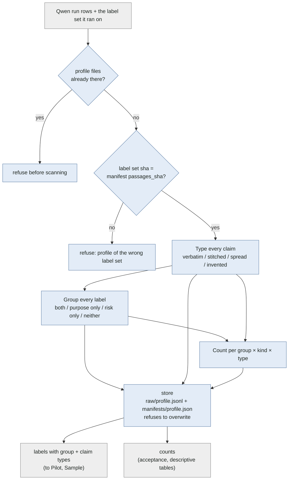

# 0011.01 Profile: every claim's type, every label's group, counted per kind

- **Status:** agreed (2026-10-22; storage agreed 2026-10-21)
- **Date:** 2026-10-20
- **Part of:** [0011 overview](00-overview.md), step 1 of the process
- **Scope:** new `engine/services/extraction_eval/` (`__init__.py`, `profile.py`,
  `schema.py`); new `engine/repositories/dsld/runs/schema.py` and additions to `paths.py`,
  `store.py`, `loader.py` there; new `tests/test_extraction_eval_profile.py` (the service)
  and additions to `tests/test_store.py` (the store and loader) **[agreed 2026-10-22]**.

Governed by ADR 0002 (latest version) and ADR 0003. Reads a finished purpose/risk run and
the label set it ran on; changes nothing about either.

Decisions are tagged as in the overview: **[agreed]**, **[proposed]**, **[open]**.

## Goal

Take an extraction run, scan it once, store and return:

- every **label** with its **group**, and the faithfulness **type** of each of its claims,
  per **kind** (`purpose` / `risk`),
- the counts **per group, per type and per kind**, for the acceptance check and the
  descriptive tables.

Deterministic, over every claim, no model and no judge. **Stored** in the run's `raw/`
folder **[agreed 2026-10-21, overview Q11]**: type and group are decided deterministically
once the run is done, so they belong with the run's own files. This lets the repository
return a sampled label together with its claims and their types ([02](02-sample.md)) without
profiling again. A stored profile could go stale; its manifest pins what it was computed from
(see [Storage](#storage-agreed-2026-10-21)).

## Flow

Process (phase 1 of the [overview's phases](00-overview.md#phases-of-the-reference-extraction-design-grilling);
same colours, grey = handoff to or from another phase):



The rarest type per label, which the sampler's strata need, is computed by the sampler from
the stored claim types ([02](02-sample.md#rarest-type-per-label-proposed)).

Calls **[agreed 2026-10-21; up-front check agreed 2026-10-22]**:

```
caller (notebook)
  build_profile(run_dir) ─► Profile
    either of runs.paths.rows_path(d, PROFILE_NAME) /
      manifest_path(d, PROFILE_MANIFEST_NAME) exists, raise          # before scanning
    rows          = runs.loader.read_rows(run_dir)                     # list[dict]
    manifest      = runs.loader.read_manifest(run_dir)
    sha, labels   = labels.loader.load_flattened(manifest["label_set"]) # dict[int, Label]
    sha == manifest["passages_sha"], else raise
    prof          = profile(rows, labels)                              # pure, no I/O
    runs.store.write_profile(run_dir, prof.labels, profile_manifest)   # refuses overwrite
```

`profile()` is the pure core; `build_profile()` is the one entry that reads, checks, computes
and saves. The service calls both repositories (ADR 0002: services → repositories; ADR 0003:
no repository reads another's data). The `passages_sha` check means a profile is never
computed against a label set the run did not read. The existence check uses the run
repository's `paths.py` and adds no repository function; `write_profile`'s own refusal stays
as the guard.

## Definitions

### Type, per claim **[agreed 2026-10-22]**

This spec is the one definition of the four types. Against the passage the model read
(`Label.passage`), where a **segment** is one line of the passage and **words** are
`str.split()` on whitespace, first match wins:

| type | rule |
|---|---|
| `verbatim` | `claim in passage` (character substring) |
| `stitched` | some segment contains every word of the claim |
| `spread` | the passage contains every word of the claim, but no single segment does |
| `invented` | some word of the claim is not in the passage |

Word containment is set membership: order and repetition are ignored. The type therefore
says where a claim's words come from, not whether its meaning survived (a reordered claim is
`stitched`); meaning is for the reference and the judges.

### Group, per label **[agreed 2026-10-22]**

From the row alone, whatever its claims' types: `both` (≥1 purpose and ≥1 risk),
`purpose_only`, `risk_only`, `neither`.

### Claim id **[agreed 2026-10-22, overview Q21]**

`claim:<dsld_id>:<kind>:<index>`, index = position in the row's `purpose` or `risk` list.
The profile stores no ids and no claim text: `purpose_types[i]` is the type of
`claim:<dsld_id>:purpose:<i>`, and the claim's text is `row["purpose"][i]["text"]`. Every
later step joins on the id. The index is stable because `rows_sha` pins the rows. Good for
now: nothing is integrated with iDISK yet.

### Edge cases **[agreed 2026-10-22]**

- **A row whose `status` is not `ok`** has no claims and no group: it gets no line in
  `raw/profile.jsonl`, is listed in `failed_ids` and left out of every count **[agreed
  2026-10-21]**. (The pinned run has none: 214,780 rows, all `ok`.)
- **A row whose `dsld_id` is not in the label set** raises: the wrong label set was passed.
- **Two rows for one `dsld_id`** raise: the run's rows are one per label. (The pinned run has
  none; the 7 rerun labels replaced their rows rather than being appended.)
- **A claim text that is empty after `.strip()`** raises rather than counting as `verbatim`
  (an empty string is a substring of everything, and a whitespace-only one has no words). The
  pinned run has none.

## Interface **[agreed 2026-10-21]**

The stored types live with the repository that stores and returns them, as `Label` lives in
`repositories/dsld/labels/` (ADR 0002 §5); the service imports them.

```python
# engine/repositories/dsld/runs/schema.py
Kind  = Literal["purpose", "risk"]
Type  = Literal["verbatim", "stitched", "spread", "invented"]
Group = Literal["both", "purpose_only", "risk_only", "neither"]

@dataclass(frozen=True)
class ProfiledLabel:
    dsld_id: int
    group: Group
    purpose_types: list[Type]   # purpose_types[i] = type of claim:<dsld_id>:purpose:<i>
    risk_types: list[Type]      # risk_types[i]    = type of claim:<dsld_id>:risk:<i>
```

```python
# engine/services/extraction_eval/schema.py
@dataclass(frozen=True)
class Profile:
    labels: list[ProfiledLabel]                          # run order, ok rows only
    claim_counts: dict[tuple[Group, Kind, Type], int]    # every cell present, zeros included
    label_counts: dict[Group, int]                       # every group present
    failed_ids: list[int]
```

```python
# engine/services/extraction_eval/profile.py
VERSION = 1   # bumped by hand when a type or group rule changes [agreed 2026-10-22]

def profile(rows: list[dict], labels: dict[int, Label]) -> Profile: ...   # pure
def build_profile(run_dir: str | Path) -> Profile: ...                     # read, check, compute, save
```

```python
# engine/repositories/dsld/runs/store.py
def write_profile(d: str | Path, labels: list[ProfiledLabel], manifest: dict) -> None: ...

# engine/repositories/dsld/runs/loader.py
def read_profile(d: str | Path) -> tuple[dict, list[ProfiledLabel]]: ...  # (manifest, labels)
```

`claim_counts` is the full group × kind × type cube; every view the evaluation needs is a sum
over it:

| view | used by | from |
|---|---|---|
| per kind × type | descriptive tables (05) | sum over group |
| per group | descriptive tables (05) | `label_counts` |
| per group × kind × type | descriptive breakdown (05) | the cube itself |
| per kind | totals (466,630 / 355,134) | sum over group and type |

`Profile` gives no marginals or shares: turning the cube into tables or shares is the
frontend's job (ADR 0002 §6) **[agreed 2026-10-22]**. The sampler builds its strata and
weights from the per-label types, not from the cube.

## Storage **[agreed 2026-10-21]**

```
data/dsld/runs/full214780-r4-2610131822-0/
  raw/ids.jsonl, raw/purpose_risk.jsonl, manifests/purpose_risk.json   (the run)
  raw/profile.jsonl        one ProfiledLabel per line, run order, ok rows only
  manifests/profile.json   the profile's manifest
```

A line of `raw/profile.jsonl`:

```json
{"dsld_id": 272809, "group": "purpose_only", "purpose_types": ["verbatim"], "risk_types": []}
```

`manifests/profile.json`:

| field | what |
|---|---|
| `run` | the run directory's name |
| `config_hash`, `passages_sha` | copied from `manifests/purpose_risk.json` |
| `rows_sha` | sha256 of `raw/purpose_risk.jsonl`, 16 hex chars like `passages_sha`; catches rows replaced in place, which leave `config_hash` unchanged. Computed by `write_profile`, since hashing the run's file is the repository's work |
| `classifier_version` | `profile.VERSION` at write time |
| `failed_ids` | ids of rows whose `status` is not `ok` |
| `claim_counts` | the cube, nested as `{group: {kind: {type: n}}}` (JSON has no tuple keys) |
| `label_counts` | `{group: n}` |

Through the run's repository, `engine/repositories/dsld/runs/`: `paths.py` gains the two
names `PROFILE_NAME = "profile.jsonl"` and `PROFILE_MANIFEST_NAME = "profile.json"` (passed
to the existing `rows_path(d, name)` / `manifest_path(d, name)`), `store.py` gains
`write_profile`, `loader.py` gains `read_profile`.

- **Write, all or nothing:** each file is written to a hidden temporary name in its own
  folder, fsynced and `os.replace`d into place, `profile.jsonl` first and `profile.json`
  last. The manifest is the commit marker: a profile exists only if its manifest does.
- **No overwrite:** `write_profile` refuses if either file exists. Re-profiling after a
  classifier change means deleting both files (and the run's `eva/`, drawn from them) by
  hand; there is no overwrite flag and no versioned file name.
- **Stale on read:** `read_profile` raises if `rows_sha`, `config_hash` or `passages_sha`
  disagree with the run's own rows and manifest, and if `profile.jsonl` exists without its
  manifest (a crashed write). The caller raises if `classifier_version != profile.VERSION`:
  the repository cannot import the service that owns `VERSION`.

## Acceptance **[agreed 2026-10-22]**

On `full214780-r4-2610131822-0` with label set `full214780-r4`, the run under this spec's
rules gives:

| check | expected |
|---|---|
| claims | 466,630 purpose, 355,134 risk |
| purpose by type | verbatim 455,043 · stitched 10,408 · spread 508 · invented 671 |
| risk by type | verbatim 353,560 · stitched 1,058 · spread 184 · invented 332 |
| labels by group | both 124,647 · purpose_only 25,418 · risk_only 46,860 · neither 17,855 |
| `failed_ids` | empty |
| purpose_only × spread / invented | 91 / 94 claims |
| risk_only × spread / invented | 53 / 27 claims |

Unit tests, in `tests/test_extraction_eval_profile.py`, on small hand-built rows and
passages: one claim per type, including a claim whose words sit in one segment but in a
different order (`stitched`), and one whose words sit in two segments (`spread`); each group;
each edge case above; `build_profile` refusing before it scans when a profile exists. Store
and loader, in `tests/test_store.py`, on a run in a temporary `RUNS_ROOT`: write then read
gives the same labels; a second write refuses; a changed rows file, a `profile.jsonl` without
its manifest, and a manifest with another `passages_sha` each make `read_profile` raise.

## Not in this spec **[agreed 2026-10-22]**

These were on the overview's step 1 list. Each goes with the step that first uses it, not
into a second version of the profile: a profile v2 would mean bumping `VERSION` and deleting
the stored profile and the `eva/` drawn from it, for columns no step needs yet.

- **Source of a claim**: the DSLD path (`statements`, `ingredientRows`, `fullName`) of the
  segment holding it. Goes with Score or the report. Needs no change to `Label` or the
  loader. The passage is the cleaned segments joined by `\n` (no segment holds a newline),
  so line *i* of `Label.passage` is segment *i*, and the source is the paths of the line(s)
  holding the claim. Cleaning and flattening are deterministic, so the segments are
  constructed for the evaluated labels only, never read from the stored set:
  `load_raw(ids)` from the local dump → `dsld_cleaning.clean()` → `CleanedLabel.segments`,
  with a check that the joined segments equal the stored passage (a mismatch means the dump
  or renderer changed; fail loudly). This also covers sets saved without `segments`
  (gold1000-r4). Checked on 200 random labels each of full214780-r4 and gold1000-r4: 0
  mismatches.
- **Rule-4 lexicon flags**: the keyword patterns behind the design doc's 0.05% / 1.7% are not
  in the engine yet and would have to be written out and agreed.
- **Purpose/risk collision**: the same text under both kinds in one label (4 labels).
  Cheap to add as a per-label flag once wanted.
- **Cut-context flags**: a negation just before the claim, a qualifier just after it. They
  only select claims for the judge, so they go with the sampler (02).
- **Run health**: attempts and retries per row. Already readable from the rows directly.
