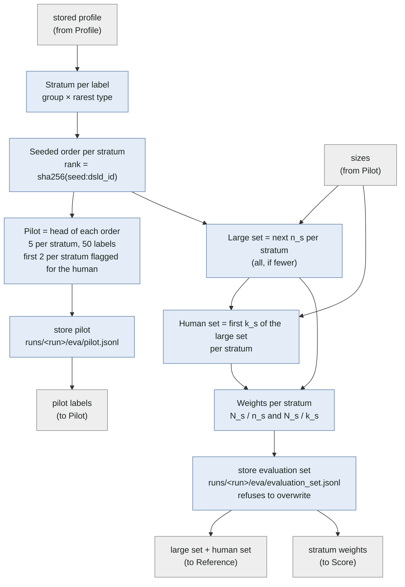

# 0011.02 Sample: a seeded, stratified draw of labels for the pilot, the large set and the human set

- **Status:** design agreed (storage and entries 2026-10-21; definitions, sizes, edge cases
  2026-10-26), ready to implement
- **Date:** 2026-10-21
- **Part of:** [0011 overview](00-overview.md), step 3 of the process (phase 3 of the
  [phases](00-overview.md#phases-of-the-reference-extraction-design-grilling)); the pilot
  draw of step 2 is also made here
- **Scope (proposed):** new `engine/services/extraction_eval/sample.py`, additions to
  `engine/services/extraction_eval/schema.py`, additions to `engine/repositories/dsld/runs/`
  (`schema.py`, `paths.py`, `loader.py`, `store.py`) for the run's `eva/` folder, new
  `tests/test_extraction_eval_sample.py`.

Governed by ADR 0002 (latest version) and ADR 0003. Reads the [profile](01-profile.md) of a
pinned run; changes nothing about the run or the label set.

Decisions are tagged as in the overview: **[agreed]**, **[proposed]**, **[open]**.

This spec follows the overview's **reference-extraction** design (label sample only). The
claim sample of the earlier design (kind × type, 1,200 claims) is not drawn here: under
reference extraction, claims come along with their labels.

## Goal

Take a profile, put every label in one **stratum**, and return three nested sets of labels:

- the **pilot**: 50 labels, drawn first, never counted in the metrics; its first 20 (2 per
  stratum) are the ones the human writes an answer key for,
- the **large set**: the labels Claude and Codex extract on (starting quotas: 1,582),
- the **human set**: the labels the human annotates blind (dry run: 150), a subset of the
  large set,

each label with its stratum, and each stratum with its **weight**, so that every rate can be
reweighted back to the run.

Deterministic given the profile and a seed. Like the profile, the sample **is stored**
**[agreed 2026-10-21]**: it is the fixed list every later step joins on, and the store
refuses to overwrite it. The large set (human set flagged) is stored as the run's
**evaluation set**.

## Why stratifying on the run's own output is safe

Group and rarest type come from Qwen's output (the profile), not from any verdict. They are
fixed before anything is judged, every label has exactly one stratum, and within a stratum
the draw is random, so every label of the run has a known, non-zero chance of being drawn.
Reweighting by that chance makes the metrics unbiased for the whole run; the strata only
decide where the sample looks harder. Three rules keep it that way:

1. A label's stratum is never changed after judging starts (the profile is pinned by the
   sample's manifest, see [Storage](#storage-agreed-2026-10-21)).
2. `neither` is sampled: it is where whole-label misses are, and recall without it would be
   too high.
3. The stratum is stored with the case but never shown to a judge or the human (packets and
   the sheet are built in step 4, which drops it and shuffles across strata).

## Flow

Process (same colours as the overview, grey = handoff to or from another phase):



The pilot is drawn and stored first; the large and human sets are drawn later, once the
pilot has fixed their sizes. Both come from the same seeded order, so drawing in two steps
gives the same labels as drawing in one.

Calls **[agreed 2026-10-21]**:

```
caller (notebook)
  build_profile(run_dir)                                                 # 01, once
  build_pilot(run_dir, quotas, seed) ─► list[SampledLabel]
    manifest, labels = runs.loader.read_profile(run_dir)                # raises if stale
    classifier_version == profile.VERSION, else raise
    pilot            = draw_pilot(prof, quotas, seed)                   # pure, no I/O
    runs.store.save_pilot(run_dir, pilot, pilot_manifest)               # refuses overwrite
  ... pilot runs (step 2), sizes decided, quotas updated ...
  build_evaluation_set(run_dir, quotas, seed) ─► Sample
    manifest, labels = runs.loader.read_profile(run_dir)                # same checks
    pilot            = [c.label for c in runs.loader.read_pilot(run_dir)]
    sample           = draw(prof, quotas, seed, pilot)                  # pure, no I/O
    runs.store.save_evaluation_set(run_dir, sample.large, set_manifest) # refuses overwrite
  later steps
    cases            = runs.loader.read_evaluation_set(run_dir)         # list[SampledCase]
```

`prof` is the `Profile` rebuilt from the stored manifest and labels. The sampler never
profiles again: no stored profile, or a stale one, raises. Quotas are an argument, recorded
in the manifests; the table below is their starting value.

## Definitions

### Rarest type, per label **[agreed 2026-10-26]**

Over all of the label's claims, both kinds together, first match wins:

| rarest | rule |
|---|---|
| `rare` | ≥1 claim is `spread` or `invented` |
| `stitched` | ≥1 claim is `stitched` |
| `verbatim` | every claim is `verbatim` |
| none | the label has no claims (group `neither`) |

Computed here from each `ProfiledLabel`'s `purpose_types` + `risk_types`, not stored in the
profile: it exists only to define strata, so it belongs to the sampler.

### Stratum **[agreed 2026-10-26]**

`(group, rarest)`: 3 groups × 3 rarest types + `(neither, none)` = **10 strata**. They
partition the run: every `ok` label has exactly one. A stratum with no labels is kept with
zeros, so every table has the same rows.

### Seeded order **[agreed 2026-10-26]**

Within a stratum, labels are sorted by `sha256(f"{seed}:{dsld_id}")`. Every set is a prefix
of this order:

```
stratum order:  [ pilot p_s          | large set n_s                    | rest ]
                [ human q_s | ...  ]  [ human k_s | ...                  ]
```

A hash rank rather than `random.Random(seed).shuffle`, because a label's position then
depends only on the seed and its own id: not on the order of the run's rows, not on which
other labels are in the stratum, and not on the Python version. The overview's "separate
seed" for the pilot is replaced by "the head of the same order": one seed, and the pilot is
excluded from the large set by construction. The human's part of the pilot is the head of
the pilot, `q_s` labels per stratum (`Quota.pilot_human`), flagged `in_human` like the human
set in the large set.

A pilot re-run (after a rubric change) uses the same 50 labels: the pilot is never counted,
and a new draw would need a new seed, which reshuffles the large set too.

The dry run (seed 20261020) used a different draw, not in the repo; its stratum sizes
reproduce, its exact labels need not.

### Quotas **[agreed 2026-10-26; final 2026-11-03: the starting values stand]**

| group | rarest | in run N_s | pilot p_s | pilot human q_s | large n_s | human k_s |
|---|---|---|---|---|---|---|
| both | rare | 1,274 | 5 | 2 | 100 | 10 |
| both | stitched | 5,096 | 5 | 2 | 150 | 10 |
| both | verbatim | 118,277 | 5 | 2 | 300 | 20 |
| purpose_only | rare | 147 | 5 | 2 | 100 | 10 |
| purpose_only | stitched | 811 | 5 | 2 | 150 | 10 |
| purpose_only | verbatim | 24,460 | 5 | 2 | 150 | 20 |
| risk_only | rare | 80 | 5 | 2 | 75 (all) | 10 |
| risk_only | stitched | 112 | 5 | 2 | 107 (all) | 10 |
| risk_only | verbatim | 46,668 | 5 | 2 | 150 | 20 |
| neither | — | 17,855 | 5 | 2 | 300 | 30 |
| **total** | | **214,780** | **50** | **20** | **1,582** | **150** |

The in-run sizes are recounted from the stored profile (2026-10-26) and match the dry run.
5 per stratum, not proportional to claims: the pilot looks for Claude vs Codex disagreement,
which is likeliest in the small rare and stitched strata.

A quota above what is left after the pilot takes all of it ("all"). The two small
`risk_only` strata lose their 5 pilot labels, hence 75 and 107 (dry run: 80 and 112).

The pilot changed none of the sizes: the stitched strata stay at 150 per group, and the
human set at 150 with the split above. The quota values the notebook passes are recorded in
`manifests/evaluation_set.json`.

### Weights **[agreed 2026-10-26]**

Per stratum, for the large set and the human set separately:

```
w_s = N_s / n_s        (large set)        w_s^H = N_s / k_s        (human set)
```

`w_s` is how many labels of the run one sampled label stands for. N_s counts the whole
stratum, pilot included: the pilot is a random head of the order, so the large set is still
a uniform random draw from the stratum, and each label's chance of being in it is n_s / N_s.
Check: `Σ n_s × w_s = 214,780`.

The overview's weight column (share of run ÷ share of large set) is the same number divided
by N / n; the store keeps `N_s`, `n_s` and `k_s`, and Score uses `w_s`.

## Interface **[agreed 2026-10-21; field details 2026-10-26]**

The stored and returned types live in the run's repository (as in [01](01-profile.md#interface-agreed-2026-10-21));
`Quota` and `Sample` stay in the service.

```python
# engine/repositories/dsld/runs/schema.py (additions)
Rarest  = Literal["rare", "stitched", "verbatim"]
Stratum = tuple[Group, Rarest | None]

@dataclass(frozen=True)
class SampledLabel:
    case_id: str         # label:<dsld_id>
    dsld_id: int
    stratum: Stratum
    rank: int            # position in the stratum's seeded order, 0-based
    in_human: bool       # pilot: the first pilot_human; large set: the first human

@dataclass(frozen=True)
class StratumSize:
    stratum: Stratum
    in_run: int          # N_s
    pilot: int           # p_s
    pilot_human: int     # q_s
    large: int           # n_s, after "all" is applied
    human: int           # k_s

@dataclass(frozen=True)
class Claim:
    claim_id: str        # claim:<dsld_id>:<kind>:<index>
    text: str            # from the run's row
    type: Type           # from the stored profile

@dataclass(frozen=True)
class SampledCase:
    label: SampledLabel
    purpose: list[Claim] # in the row's order: purpose[i] is claim:<dsld_id>:purpose:<i>
    risk: list[Claim]
```

```python
# engine/services/extraction_eval/schema.py (additions)
@dataclass(frozen=True)
class Quota:
    pilot: int
    pilot_human: int     # ≤ pilot
    large: int
    human: int           # ≤ large

@dataclass(frozen=True)
class Sample:
    seed: int
    pilot: list[SampledLabel]
    large: list[SampledLabel]     # stratum order, then rank; human set = in_human
    sizes: list[StratumSize]      # all 10 strata
```

```python
# engine/services/extraction_eval/sample.py
def draw_pilot(profile: Profile, quotas: dict[Stratum, Quota], seed: int) -> list[SampledLabel]: ...  # pure
def draw(profile: Profile, quotas: dict[Stratum, Quota], seed: int,
         pilot: list[SampledLabel]) -> Sample: ...                                            # pure
def build_pilot(run_dir: str | Path, quotas: dict[Stratum, Quota], seed: int) -> list[SampledLabel]: ...
def build_evaluation_set(run_dir: str | Path, quotas: dict[Stratum, Quota], seed: int) -> Sample: ...
```

```python
# engine/repositories/dsld/runs/store.py
def save_pilot(d: str | Path, pilot: list[SampledLabel], manifest: dict) -> None: ...
def save_evaluation_set(d: str | Path, large: list[SampledLabel], manifest: dict) -> None: ...

# engine/repositories/dsld/runs/loader.py
def read_pilot(d: str | Path) -> list[SampledCase]: ...
def read_evaluation_set(d: str | Path) -> list[SampledCase]: ...   # human set: c.label.in_human
```

`draw` checks that `pilot` is exactly `draw_pilot(profile, quotas, seed)`; a mismatch means
the profile, quotas or seed changed between the two steps, and it raises. Weights are not
stored as floats: they are `in_run / large`, computed where used.

## Storage **[agreed 2026-10-21]**

The evaluation dataset lives with the run it evaluates, in the run's own `eva/` folder. One
evaluation per run (overview Q3), so there is no evaluation id. The pilot and the evaluation
set are written at different times (the pilot decides the set's sizes), so each has its own
file and manifest, laid out like the run's own `raw/` + `manifests/`:

```
data/dsld/runs/full214780-r4-2610131822-0/
  raw/ids.jsonl, raw/purpose_risk.jsonl, manifests/purpose_risk.json   (the run)
  raw/profile.jsonl, manifests/profile.json                            (its profile, 01)
  eva/
    pilot.jsonl                    one SampledLabel per line
    evaluation_set.jsonl           one SampledLabel per line (large set; human set flagged)
    manifests/pilot.json           run, profile_sha, rows_sha, classifier_version, seed,
                                   quotas, sizes per stratum
    manifests/evaluation_set.json  the same, plus pilot_sha
```

A stored line holds the stratum as two flat fields, `group` and `rarest` (`null` for
`neither`), beside `case_id`, `dsld_id`, `rank` and `in_human`; the manifests hold `quotas`
and `sizes` as lists of `{group, rarest, ...}` objects in the fixed order of the 10 strata.
In Python the stratum stays the tuple `Stratum`.

`profile_sha` is the sha256 of `raw/profile.jsonl`, `pilot_sha` of `eva/pilot.jsonl`, 16 hex
chars like `passages_sha`.

Read and written through the run's repository, `engine/repositories/dsld/runs/` (ADR 0003:
the evaluation is data about a run, so no new repository folder): `paths.py` gains the `eva/`
locations, `store.py` gains `save_pilot` and `save_evaluation_set`, `loader.py` gains
`read_pilot` and `read_evaluation_set`.

- **Write, all or nothing:** as the profile ([01](01-profile.md#storage-agreed-2026-10-21)):
  lines first, manifest last as the commit marker; each save refuses if either of its files
  exists.
- **Joined on read:** a stored line is ids and strata only. The read joins each sampled label
  with its claims' text (from `raw/purpose_risk.jsonl`) and type (from `raw/profile.jsonl`)
  by `dsld_id` and index, and returns `SampledCase`s. All three files are the run's
  repository's own, so the join is inside it (ADR 0003, rule 2). The passage is not joined:
  it is the label set's (`labels/`), so the caller joins it, `passages_sha` checked.
- **Stale on read:** `read_pilot` and `read_evaluation_set` raise if `profile_sha` or
  `rows_sha` no longer match the files in `raw/`, so a changed run or profile is caught before
  a weight is applied to the wrong stratum.

Later steps (reference extractions, answer key, verdicts) add their own files and manifests
under `eva/`.

## Edge cases **[agreed 2026-10-26]**

- **A quota for a stratum not in the 10** raises; **a stratum with no quota** raises (no
  stratum is skipped silently).
- **`human > large`** or **`pilot_human > pilot`** in a quota raises.
- **A stratum smaller than its pilot quota** gives all its labels to the pilot and none to
  the large set; its weight is then undefined and `draw` raises, since the metrics could not
  cover it.
- **`failed_ids` in the profile** are in no stratum and cannot be drawn; their count goes in
  the manifest. (The pinned run has none.)
- **No stored profile, a stale one, or `classifier_version != profile.VERSION`**:
  `build_pilot` and `build_evaluation_set` raise; they never profile again.
- **`build_evaluation_set` before `build_pilot`** raises: there is no pilot to check.

## Acceptance

On `full214780-r4-2610131822-0`, seed 20261020, the quotas above:

| check | expected |
|---|---|
| strata | 10, in-run sizes as in the quota table, summing to 214,780 |
| pilot | 50 labels, 5 per stratum, the first 2 of each `in_human` (20) |
| large set | 1,582 labels, sizes as in the table, disjoint from the pilot |
| human set | 150 labels, the first k_s of each stratum's large set |
| weights | `Σ n_s × N_s / n_s = 214,780` |
| determinism | two draws give identical files; row order of the run does not matter |

Unit tests on a small hand-built profile: rarest type for each rule; stratum partition;
nesting (pilot human, then pilot, then human, then large, one order); "all" when the quota exceeds the
stratum; `draw` raising on a pilot that does not match; each edge case above. Store and
loader, on a run in a temporary `RUNS_ROOT`: save then read gives `SampledCase`s whose
claims match the rows' text and the profile's types by index; a second save refuses; a
changed profile or rows file makes the read raise.

## Not in this spec

- **The claim sample** (kind × type) of the overview's first design: not drawn under
  reference extraction. If both designs are kept, it is a third draw over the profile's
  claims with the same hash order, keyed by claim id.
- **Packets and the human sheet**: building them, hiding the stratum and shuffling across
  strata are step 4's.
- **Choosing the sizes**: the pilot decides them (overview, Pilot); this spec only takes
  them as quotas.

## Open questions

None. The sizes are final (see Quotas).
